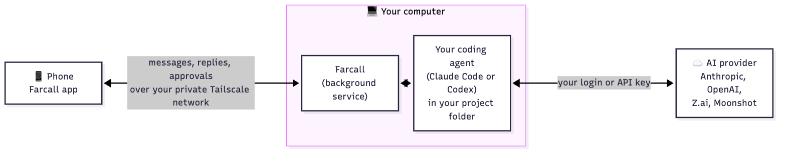

# Farcall

**Run your coding agents from your phone. Every agent, your choice of model, your own computer, no cloud relay.**

*Like having your terminal's Claude Code or Codex in your pocket, minus the tiny keyboard.*

They work on your computer, in your projects. You chat, watch the replies stream in, and approve every command before it runs, from anywhere.

- **Your agent, your model.** Claude Code on your Claude login, or on Z.ai's GLM or Moonshot's Kimi. Codex on OpenAI (preview). Pick per session.
- **No server in the middle.** Your phone reaches your computer over your own private [Tailscale](https://tailscale.com) network. Your chats and code stay on your machines.
- **You stay in charge.** When the agent wants to run a command or edit a file, your phone asks first.
- **Mac, Windows and Linux** on the computer side, Android on the phone.

<p align="center"></p>

This repository holds the builds only. **[Download the latest release](https://github.com/eamon831/farcall-releases/releases/latest)**

## What you need

- **A computer** that stays on while you use it: a Mac (Apple Silicon, macOS 13+), a Windows PC (64-bit Windows 10 or 11) or a Linux machine (x64, Ubuntu 22.04 or newer or a similar distribution, with a desktop and systemd).
- **An Android phone.**
- **An account with an AI provider.** The usual path is a Claude account: Farcall's setup installs Claude Code and signs you in. A Z.ai or Moonshot API key works too (setup's **Other models** step). For Codex, install it and sign in yourself first; Farcall picks it up.
- **A Tailscale account**, free for personal use. You sign in from inside Farcall on both devices; the Tailscale app itself is not needed.

## Getting started

**1. Install Farcall on the computer.** Pick your system below. Each installer downloads the newest build, checks it against the release's checksum, installs it for your account only and opens it.

<details open>
<summary><b>Mac</b></summary>

In Terminal:

```sh
curl -fsSL https://github.com/eamon831/farcall-releases/releases/latest/download/install.sh | bash
```

Prefer a disk image? Download `Farcall.dmg` from the release, drag Farcall to Applications and open it. The first time, macOS says it can't verify the app (Farcall isn't signed with an Apple Developer ID yet): click Done, then System Settings › Privacy & Security › **Open Anyway**. The Terminal way skips this.
</details>

<details>
<summary><b>Windows</b> (new)</summary>

In PowerShell (no administrator needed):

```powershell
irm https://github.com/eamon831/farcall-releases/releases/latest/download/install.ps1 | iex
```

Installs into `%LOCALAPPDATA%\Programs\Farcall` and adds Farcall to the Start menu.
</details>

<details>
<summary><b>Linux</b> (new)</summary>

In a terminal (no sudo):

```sh
curl -fsSL https://github.com/eamon831/farcall-releases/releases/latest/download/install-linux.sh | bash
```

Installs into `~/.local/opt/farcall` and adds a menu entry.
</details>

You can read each script before running it: [install.sh](https://github.com/eamon831/farcall-releases/releases/latest/download/install.sh), [install.ps1](https://github.com/eamon831/farcall-releases/releases/latest/download/install.ps1), [install-linux.sh](https://github.com/eamon831/farcall-releases/releases/latest/download/install-linux.sh).

**2. Follow the setup in the Farcall window.** It goes one step at a time and checks each one: the background service, Tailscale sign-in, Claude Code and its login, a short approval test, and the folder your projects live in. About ten minutes.

**3. Install the phone app.** The setup's phone step shows a QR code; scan it with the phone's camera, or download `farcall.apk` from the release. Allow installing from your browser when Android asks.

**4. Connect and pair.** Open Farcall on the phone. Under **Connect this phone**, tap **Sign in** and use the same Tailscale account as the computer. Then tap **Pair phone** in the computer's window and scan its code with **Scan the code** on the phone.

That's it. On the phone, tap **Start a new session**, pick a project folder, and chat.

## Keep the computer awake

Farcall runs on your computer, so it only works while that computer is awake. A sleeping computer shows as offline on the phone, and a reply the agent was writing stops until it wakes. Farcall can't wake it from the phone.

Turn off automatic sleep while it's plugged in:

- **Mac desktop** (Mac mini, iMac, Mac Studio): System Settings › Energy › turn on **Prevent automatic sleeping when the display is off**.
- **MacBook:** System Settings › Battery › Options › turn on **Prevent automatic sleeping on power adapter when the display is off**. Keep it plugged in. Closing the lid still puts it to sleep, unless an external display is connected.
- **Windows:** Settings › System › Power (Power & battery on Windows 11) › set sleep **when plugged in** to **Never**.
- **Linux** (Ubuntu): Settings › Power › turn off **Automatic Suspend** (at least when plugged in).

The screen can still turn off. Only the computer has to stay awake.

## Privacy and security

- **No middleman.** The phone reaches the computer directly over your Tailscale network. Farcall runs no server and never sees your chats, code or files.
- **Paired devices only.** The computer listens only on its Tailscale address and accepts only phones that scanned its pairing code.
- **You approve each command.** By default the agent asks before it runs a command or edits a file, and the request comes to your phone. You can choose looser modes per session.
- **Crash reports** are on by default and can be turned off any time (phone: Settings › Privacy; computer: **Check setup** in the Farcall window). They contain only the error and where in Farcall it happened, with folder names, network addresses and keys removed: never your chats or files. They go to [Sentry](https://sentry.io).

## Updating and uninstalling

Farcall checks for updates itself: **Check for update** in the computer window and in the phone's Settings. Updates install in place and keep your sessions and pairing.

To remove it from a computer, use **Uninstall…** in the Farcall window. It stops the background service and removes the app, and with it Farcall's data and pairing (untick the box to keep those). Your Claude Code install and conversations are left alone. On the phone, uninstall the app as usual.

## When something doesn't work

- **The phone can't reach the computer:** check that the computer is awake (see [Keep the computer awake](#keep-the-computer-awake)), that its Farcall setup shows Tailscale ✓, and that the phone is signed in to the **same** Tailscale account (phone: Settings › Connection).
- **The first connection after an update takes a few seconds:** the built-in Tailscale is starting up. It settles by itself.
- **macOS won't open the app:** see the Mac section above (Open Anyway), or install from Terminal.

## Feedback

[Report a problem or suggest a feature](https://github.com/eamon831/farcall-releases/issues/new/choose). In the app, **Report a problem / Suggest a feature** opens the same form with your versions filled in. A GitHub account is needed, and reports are public, so look through any log lines before pasting them.

## Third-party software

Farcall includes Tailscale's open-source client (`tailscaled`, BSD-3-Clause, © Tailscale Inc & contributors) so your devices can connect without the Tailscale app. Its license is in `Farcall.app/Contents/Resources/tailscale/LICENSE` on a Mac, and in `tailscale/LICENSE` inside the install folder on Windows and Linux.
