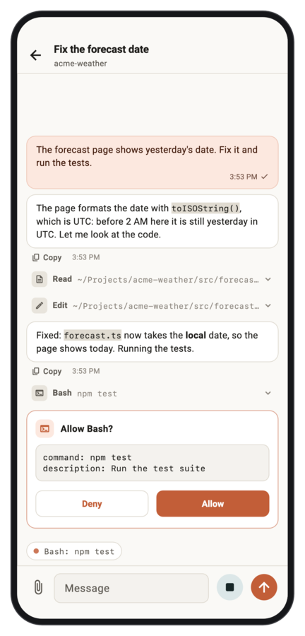
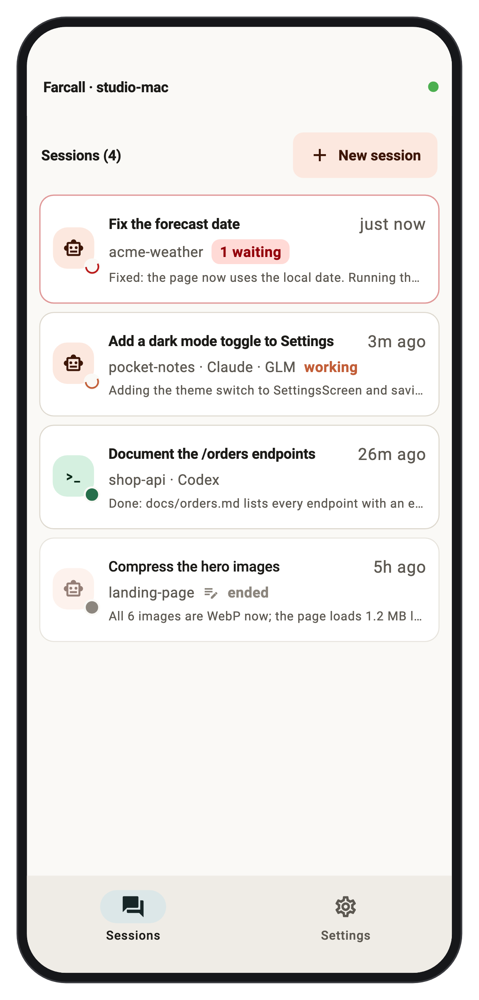
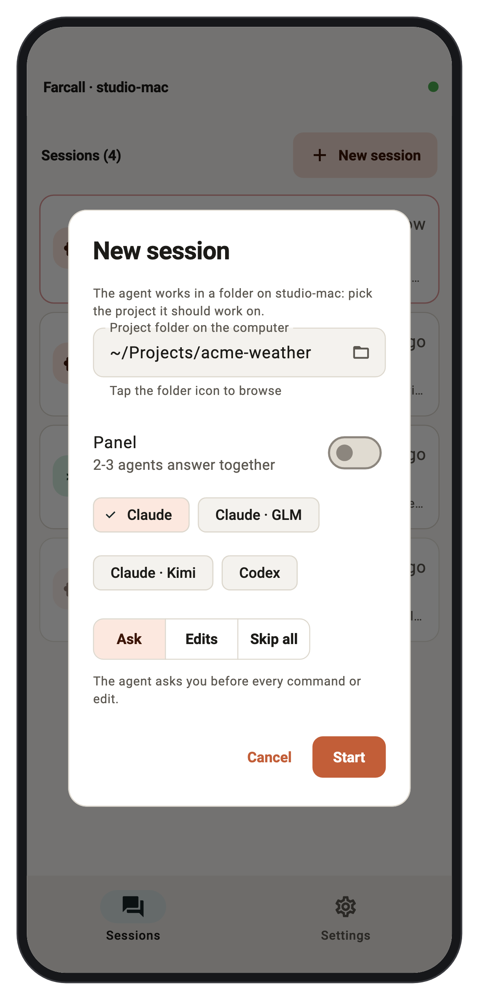
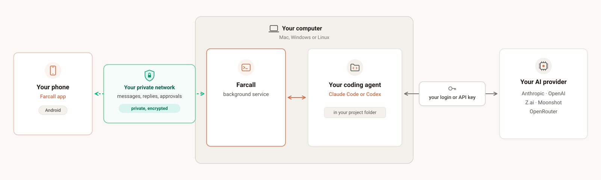
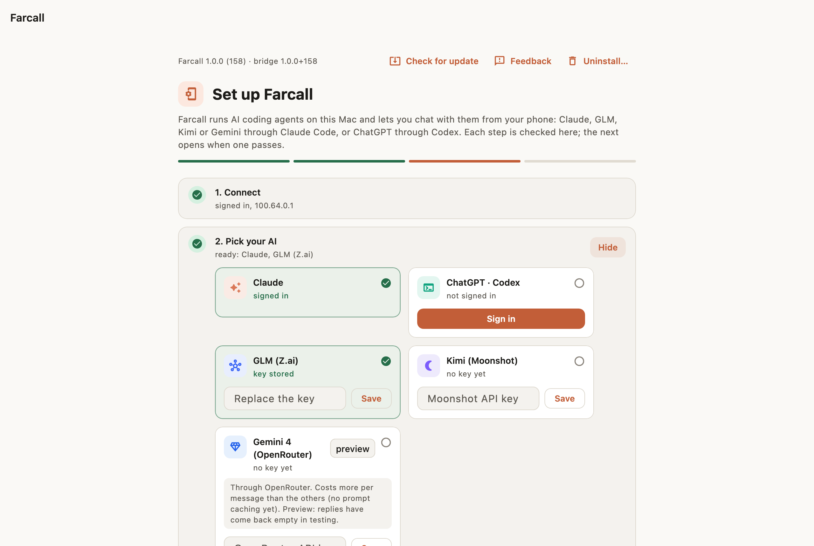

# Farcall

**Ship from your phone.** Your AI agents run on your computer: Claude Code, Codex, GLM, Kimi, whichever you use. You direct them from anywhere: say what you want, send a screenshot, check the result, ship it. Farcall itself was built this way.

Your code stays on your computer and never passes through Farcall's server. When the agent finishes or needs you, your phone tells you.

*Using another coding CLI? [Tell us which one →](https://github.com/eamon831/farcall-releases/issues/1)*

<p align="center">
  <picture><source media="(prefers-color-scheme: dark)" srcset="images/shot-phone-chat-dark.png"></picture>
  <picture><source media="(prefers-color-scheme: dark)" srcset="images/shot-phone-sessions-dark.png"></picture>
  <picture><source media="(prefers-color-scheme: dark)" srcset="images/shot-phone-new-session-dark.png"></picture>
</p>

- **Your agent, your model.** Claude Code on your Claude login, or on Z.ai's GLM or Moonshot's Kimi; Gemini through OpenRouter (preview). Codex on your OpenAI login (preview). Pick per session.
- **It tells you when it needs you.** A notification when the agent finishes, with the end of its reply, or when it has a question you can answer with a tap. Want it to ask before commands and edits? It does by default: Allow or Deny, from anywhere.
- **Your code stays on your machines.** Sign in with Google on both, and your phone reaches your computer over a private, encrypted network built into Farcall (it runs on [Tailscale](https://tailscale.com)'s open-source client): no Tailscale app, no QR code to scan. Farcall's server only signs your devices in.
- **Mac, Windows and Linux** on the computer, **Android** on the phone. iPhone: not yet.

## When you'd reach for it

The agent runs on your own computer, with your files, tools and logins, and does
the typing. So a phone is enough to drive it: you say what you want and check
what it did. It works with your Claude login or with keys for GLM, Kimi or
OpenRouter.

**Start it, then walk away.** "Run the tests and fix what fails." Go make tea.
When it's done, or stuck on a question, your phone tells you, and you send the
next step from wherever you are.

**A bug you found on your phone, fixed from your phone.** Screenshot the
problem, send it to the agent working on that app, check what it changed, then
install the build it makes. Farcall is built this way; [see how](https://farcall.app/#workflow).

**"Why is this broken?" from anywhere.** The agent reads the logs and the code
on your computer and tells you what went wrong. Nothing gets pasted into a
chatbot.

**Not just code.** Farcall's developer keeps a fitness log in a git repo: a
photo of a meal before eating it, a note after the gym, and the agent writes it
into Markdown. In use 10 of the last 14 days, and no fitness app was ever built
for it.

**Why not SSH and tmux?** You can. Farcall is for when you'd rather not type in
a terminal on a phone keyboard: a notification when the agent is done or waiting
for you, photos and files straight into the chat, and answers as buttons.

### Keep the memory in the repo

Phone sessions work best when you don't have to scroll back to remember where
you were. Have the agent keep its state in git:

- a `CLAUDE.md` (or `AGENTS.md` for Codex) with the project's rules
- a short status file it updates at the end of a session
- commit messages that say why, not just what
- push, so any session on any computer starts where the last one stopped

Then five minutes from your phone picks up where yesterday left off.

**Not for:** writing code by hand on a phone, a computer that's asleep, or
reviewing a big diff (that's still desk work). Android only for now; iPhone:
not yet.

## How is it different?

Remote apps for coding agents usually tie you to one agent, one account, or a company server that sits in your session. Farcall:

- **Works with any of your providers**, not one account: Claude, GLM, Kimi, Gemini (OpenRouter) and Codex, side by side. Anthropic's Remote Control accepts only Anthropic's own API, so Claude Code on GLM, Kimi or OpenRouter works here and not there.
- **Nothing to keep open on your computer.** Farcall runs as a background service, so sessions keep going when the phone disconnects or the computer restarts.
- **Keeps your work off its server.** Farcall's server only signs your devices in. Phone and computer connect over a private network, encrypted end to end by WireGuard (Tailscale's network, built into Farcall). When they can't reach each other directly, Tailscale's relays pass the encrypted traffic on without being able to read it.
- **Asks before commands if you want it to**, with the request on your phone, not just a notification after the fact. It's the default; switch a session to Skip all when you don't.
- **Can put two or three agents in one chat** (a panel): they answer side by side and can discuss each other's answers.
- **Updates your computer from your phone:** Settings › Update Farcall on that computer.

<p align="center"><picture><source media="(prefers-color-scheme: dark)" srcset="images/diagram-wide-dark.svg"></picture></p>

**Website: [farcall.app](https://farcall.app)** · This repository holds the builds only. **[Download the latest release](https://github.com/eamon831/farcall-releases/releases/latest)**

## What you need

- **A computer** that stays on while you use it: a Mac (Apple Silicon, macOS 13+), a Windows PC (64-bit Windows 10 or 11) or a Linux machine (x64, Ubuntu 22.04 or newer or a similar distribution, with a desktop and systemd).
- **An Android phone.**
- **One AI to work with**, any of: a Claude account (setup signs you in), a Z.ai (GLM), Moonshot (Kimi) or OpenRouter (Gemini, preview) API key, or Codex signed in to your OpenAI account. One is enough; setup installs Claude Code when the one you pick needs it.
- **A Google account.** You sign in with it inside Farcall on the phone and on the computer. No Tailscale account or app is needed.

## Getting started

**1. Install Farcall on the computer.** Pick your system below. Each installer downloads the newest build, checks it against the release's checksum, installs it for your account only and opens it.

<details open>
<summary><b>Mac</b></summary>

In Terminal:

```sh
curl -fsSL https://github.com/eamon831/farcall-releases/releases/latest/download/install.sh | bash
```

Prefer a disk image? Download `Farcall.dmg` from the release, drag Farcall to Applications and open it. The first time, macOS says it can't verify the app (Farcall isn't signed with an Apple Developer ID yet): click Done (or Cancel on older macOS), then System Settings › Privacy & Security › **Open Anyway**. The Terminal way skips this.
</details>

<details>
<summary><b>Windows</b> (new)</summary>

In PowerShell (no administrator needed):

```powershell
irm https://github.com/eamon831/farcall-releases/releases/latest/download/install.ps1 | iex
```

Installs into `%LOCALAPPDATA%\Programs\Farcall` and adds Farcall to the Start menu.

Windows may show "Windows protected your PC" (either way of installing): click **More info**, then **Run anyway**. The build is not yet code-signed.
</details>

<details>
<summary><b>Linux</b> (new)</summary>

In a terminal (no sudo):

```sh
curl -fsSL https://github.com/eamon831/farcall-releases/releases/latest/download/install-linux.sh | bash
```

Installs into `~/.local/opt/farcall` and adds a menu entry.
</details>

You can read each script before running it: [install.sh](https://github.com/eamon831/farcall-releases/releases/latest/download/install.sh), [install.ps1](https://github.com/eamon831/farcall-releases/releases/latest/download/install.ps1), [install-linux.sh](https://github.com/eamon831/farcall-releases/releases/latest/download/install-linux.sh).

**2. Follow the setup in the Farcall window.** Each step is checked for you: **Connect** (sign in with Google), **Pick your AI** (sign in, or paste a key), **Projects folder**, **Connect your phone**. Farcall installs Claude Code and checks that approvals reach your phone by itself.

<p align="center"><picture><source media="(prefers-color-scheme: dark)" srcset="images/shot-desktop-setup-dark.png"></picture></p>

**3. Install the phone app.** The setup's phone step shows a QR code; scan it with the phone's camera, or download `farcall.apk` from the release. Allow installing from your browser when Android asks.

**4. Sign in on the phone.** Open Farcall on the phone and tap **Sign in with Google**, with the same account as the computer. The computer shows up by itself; there is no code to type.

To get a friend started, **Settings › Share app** on your phone sends them the app over WhatsApp, Bluetooth or anything else the share sheet offers. Farcall speaks English and Bengali: on the phone, **Settings › Language**; the computer's window follows your system language.

That's it. On the phone, tap **Start a new session**, pick a project folder, and chat.

## Keep the computer awake

Farcall runs on your computer, so it only works while that computer is awake. A sleeping computer shows as offline on the phone, and a reply the agent was writing stops until it wakes. Farcall can't wake it from the phone.

Turn off automatic sleep while it's plugged in:

- **Mac desktop** (Mac mini, iMac, Mac Studio): System Settings › Energy › turn on **Prevent automatic sleeping when the display is off**.
- **MacBook:** System Settings › Battery › Options › turn on **Prevent automatic sleeping on power adapter when the display is off**. Keep it plugged in. Closing the lid still puts it to sleep, unless an external display is connected.
- **Windows:** Settings › System › Power (Power & battery on Windows 11) › set sleep **when plugged in** to **Never**.
- **Linux** (Ubuntu): Settings › Power › turn off **Automatic Suspend** (at least when plugged in).

The screen can still turn off. Only the computer has to stay awake.

## Battery on the phone

So that approvals and replies reach you while Farcall is closed, the phone keeps one connection to your computer open, and that uses some battery. To save it, turn off **Settings › Background connection**: Farcall is then connected only while it is open, and sends no notifications while it is closed. The **Keep off** button on Farcall's notification does the same.

## Privacy and security

- **Your work stays on your devices.** The phone reaches the computer over a private network, encrypted end to end by WireGuard (Tailscale's, built into Farcall). Farcall's sign-in server keeps your Google email and your devices' names, and never sees your chats, code or files. Details on the [privacy page](https://farcall.app/privacy/); sign out or delete your account from the phone's Settings.
- **Your devices only.** The computer is reachable only through its private network and accepts only phones signed in to the same Google account. A phone you remove under **Settings › Devices on your Google account** is cut off within a minute.
- **You approve each command.** By default the agent asks before it runs a command or edits a file, and the request comes to your phone. You can choose looser modes per session.
- **Who makes it.** Made by MD Saiful Hossain ([@eamon831](https://github.com/eamon831)), who built Farcall to run his own Claude Code sessions from his phone. The source isn't public yet. Every build here is published with its SHA-256, and each installer checks it before installing, for your account only.
- **Crash reports** are on by default and can be turned off any time (phone: Settings › Privacy; computer: **Settings › Check setup** in the Farcall window). They contain only the error and where in Farcall it happened, with folder names, network addresses and keys removed: never your chats or files. They go to [Sentry](https://sentry.io).

## Updating and uninstalling

Farcall checks for updates itself: **Check for update** in the computer window and in the phone's Settings. Updates install in place and keep your sessions and sign-in.

To remove it from a computer, use **Uninstall…** in the Farcall window. It stops the background service and removes the app, and with it Farcall's data and sign-in (untick the box to keep those). Your Claude Code install and conversations are left alone. On the phone, uninstall the app as usual.

## When something doesn't work

- **The phone can't reach the computer:** check that the computer is awake (see [Keep the computer awake](#keep-the-computer-awake)), that its Farcall setup shows Connect ✓, and that the phone is signed in with the **same** Google account (phone: Settings › Google account).
- **The first connection after an update takes a few seconds:** the built-in Tailscale is starting up. It settles by itself.
- **macOS won't open the app:** see the Mac section above (Open Anyway), or install from Terminal.

## Feedback

[Report a problem or suggest a feature](https://github.com/eamon831/farcall-releases/issues/new/choose). In the app, **Report a problem / Suggest a feature** opens the same form with your versions filled in. A GitHub account is needed, and reports are public, so look through any log lines before pasting them.

## Third-party software

Farcall includes Tailscale's open-source client (`tailscaled`, BSD-3-Clause, © Tailscale Inc & contributors) so your devices can connect without the Tailscale app. Its license is in `Farcall.app/Contents/Resources/tailscale/LICENSE` on a Mac, and in `tailscale/LICENSE` inside the install folder on Windows and Linux.
